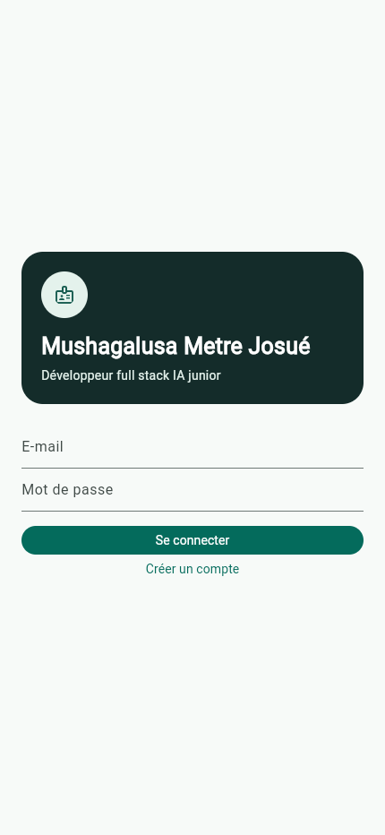
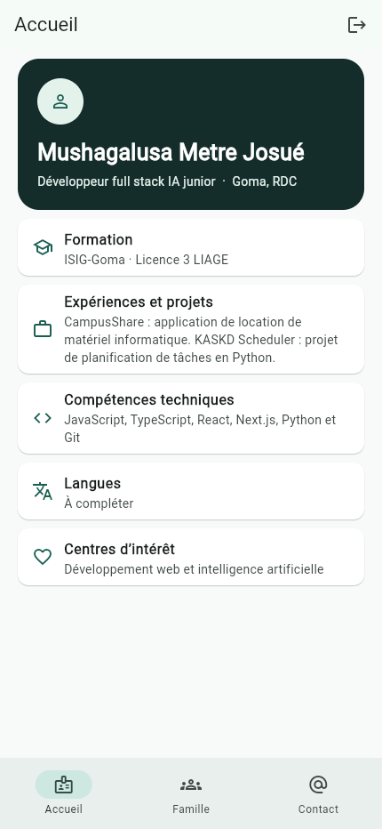
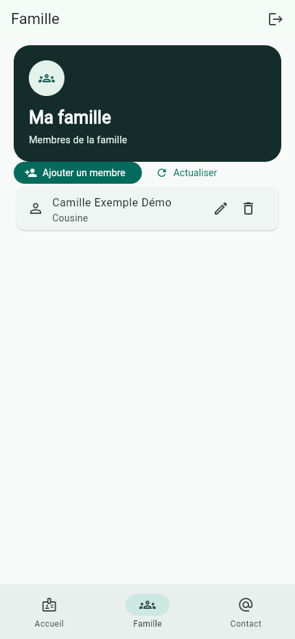

# CV Flutter — Josué

Application Flutter de présentation du CV, de la famille et des coordonnées. Le serveur vérifie l’adresse e-mail et le mot de passe avant d’ouvrir le portfolio. La page **Famille** permet de consulter, ajouter, modifier et supprimer des membres dans la base MySQL ou MariaDB de l’API.

## Démonstration vidéo

[Regarder ou télécharger la démonstration WebM](docs/demonstration.webm)

La vidéo montre la création d’un compte, le refus d’un mot de passe incorrect, la connexion, l’ajout et la consultation d’un membre, sa modification, la lecture des données après rechargement, puis la suppression et la déconnexion. Le workflow **Vérifier Flutter et capturer les écrans** peut régénérer la vidéo et les captures avec une base de démonstration vierge.

## Installer l’API

1. Suivez le [README de l’API du cours](https://github.com/espoirbaraka/api-test#installation). Avec XAMPP, placez le dépôt de l’API dans `C:\xampp\htdocs\api-test` et démarrez Apache et MySQL.
2. Créez la base `api` et importez le fichier `api.sql` fourni avec l’API. Copiez `.env.example` vers `.env` et renseignez la connexion à la base.
3. Vérifiez que `http://localhost/api-test/public/famille-membres` renvoie une réponse JSON.

## Lancer Flutter

```sh
flutter pub get
flutter run -d chrome --dart-define=API_BASE_URL=http://localhost/api-test/public
```

Sur un émulateur Android, utilisez `http://10.0.2.2/api-test/public`. Sur un téléphone, utilisez l’adresse réseau du serveur accessible depuis le téléphone. Conservez le segment `/public`. L’application utilise `http://localhost/api-test/public` par défaut. Pour un serveur distant, configurez une URL HTTPS.

Sur l’écran de connexion, choisissez **Créer un compte** si nécessaire, puis **Se connecter**. Une base fraîchement importée affiche une liste vide. Dans **Famille**, touchez un membre pour ouvrir sa fiche ou utilisez les boutons de modification et de suppression. Le formulaire envoie les six champs requis et conserve la photo existante lors d’une modification. Les portraits disponibles sur le serveur sont affichés dans la fiche.

L’API du cours vérifie le mot de passe sur `POST /accounts/login` et renvoie le compte. Le contrôle d’accès au portfolio se fait dans Flutter. Les routes de gestion de l’API fournie restent publiques et utilisent une liste commune à tous les comptes. Hébergez cette instance de démonstration sur un réseau de confiance.

Le contenu du CV et les coordonnées se personnalisent dans `lib/profile.dart`.

## Vérifier le projet

```sh
flutter analyze
flutter test
```

## Captures d’écran

| Connexion | Accueil |
| --- | --- |
|  |  |

| Famille | Contact |
| --- | --- |
|  |  |
