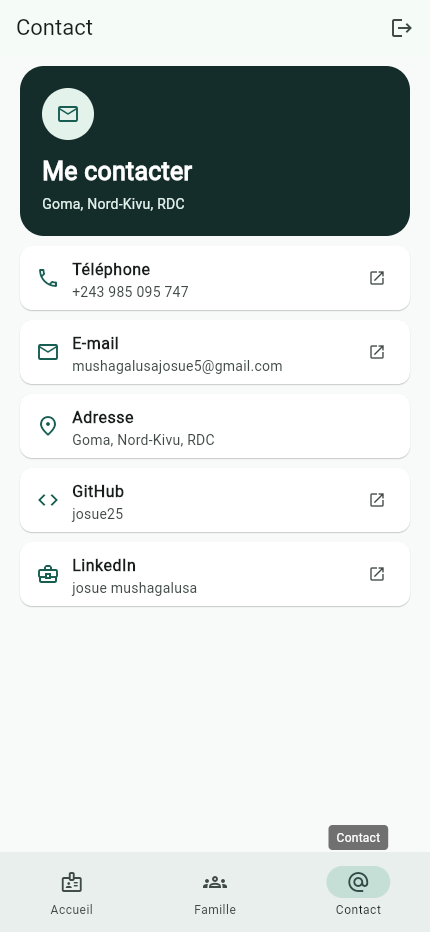

# CV Flutter — Josué

Application Flutter de présentation du CV, de la famille et des coordonnées. L’accès se fait par le bouton « Se connecter », puis une barre de navigation relie Accueil, Famille et Contact.

## Lancer le projet

Avec Flutter stable installé, ouvrez un terminal dans le dossier `cv_flutter_josue`.

```sh
flutter create --platforms=android,ios,web .
flutter pub get
flutter analyze
flutter run
```

Pour une première vérification sur ordinateur, utilisez `flutter run -d chrome`. Pour tester la version mobile, démarrez un émulateur Android ou branchez un téléphone et sélectionnez-le dans `flutter devices`. La compilation iOS s’effectue sur macOS.

Le bouton **Se connecter** ouvre directement le CV. Le dépôt et ses captures sont publics.

## Personnaliser le contenu

- Vérifiez le CV dans `lib/main.dart` et saisissez vos coordonnées et les membres de votre famille dans `lib/profile.dart`. Les entrées vides de la page Contact restent inactives. Renseignez les liens sociaux en HTTPS.
- Ajoutez les portraits dans `assets/portraits/`, renseignez leur chemin dans `lib/profile.dart`, puis déclarez le dossier dans `pubspec.yaml`, sous la section `flutter`, au même niveau que `uses-material-design`.

```yaml
  assets:
    - assets/portraits/
```

## Captures d’écran

Le workflow GitHub Actions **Vérifier Flutter et capturer les écrans** compile l’application et photographie les quatre pages Flutter Web dans une fenêtre de taille mobile. Il ajoute les PNG au dépôt sur la branche `main`. Ces images s’affichent ici après une exécution réussie.

| Connexion | Accueil |
| --- | --- |
|  |  |

| Famille | Contact |
| --- | --- |
|  |  |

Si le workflow produit les captures mais que GitHub refuse le commit automatique, téléchargez l’artefact **captures-flutter** depuis l’onglet **Actions**, placez les images dans `docs/screenshots/` et ajoutez-les au dépôt.

## Publier le dépôt

Avec Git et la CLI GitHub installés, exécutez ces commandes à la racine du projet.

```sh
gh auth login
git init -b main
git add .
git commit -m "Créer le CV Flutter de Josué"
gh repo create cv_flutter_josue --public --source . --remote origin --push
```

Le lien du dépôt s’affiche après sa création. Avant de le remettre, vérifiez que les quatre captures apparaissent dans le README sur GitHub.
